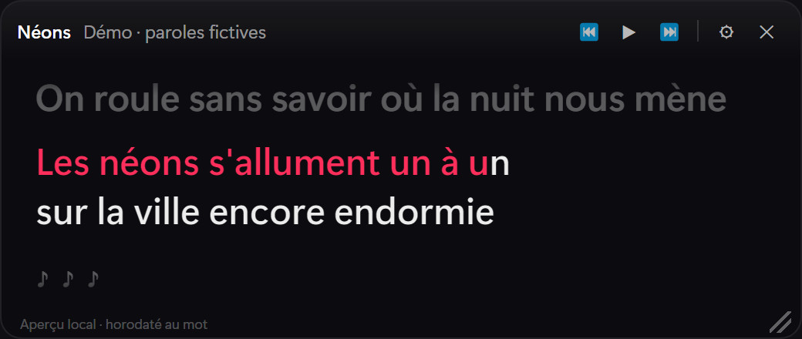
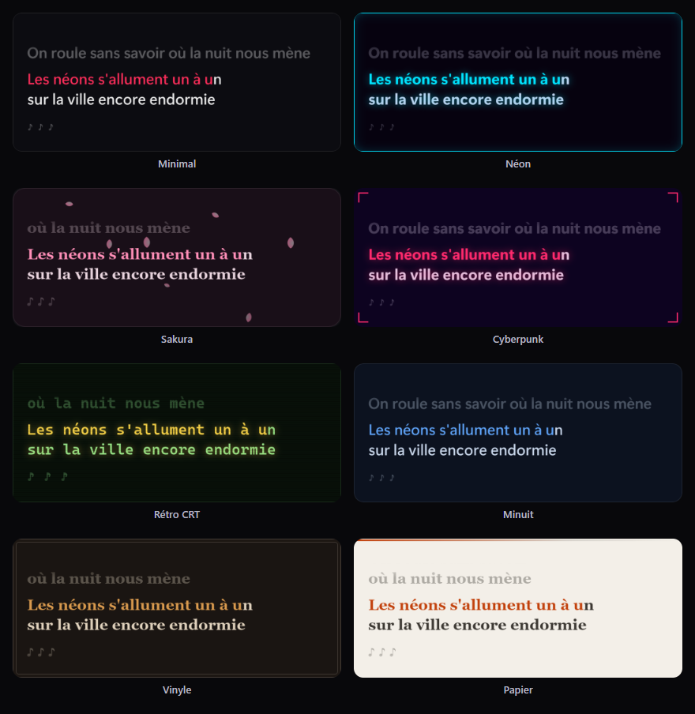
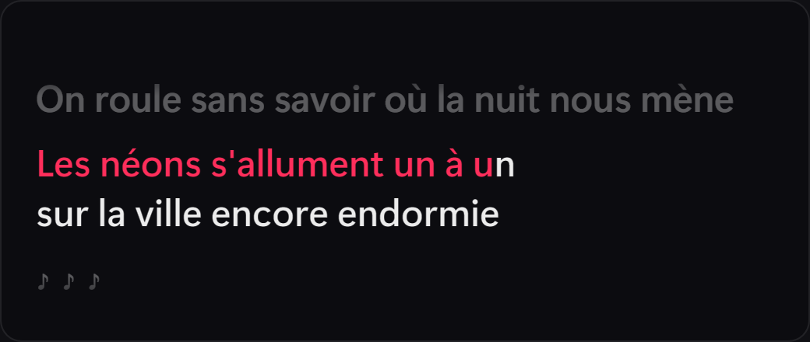
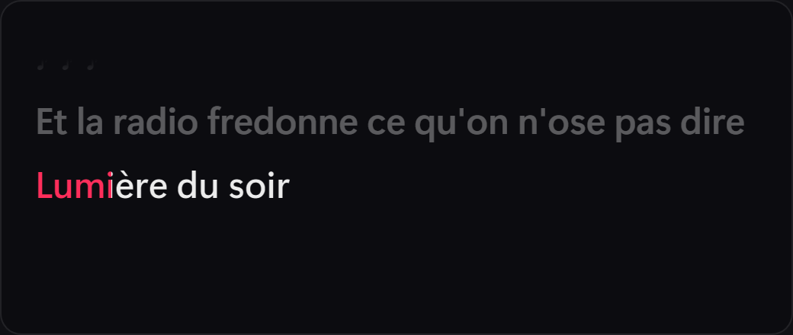
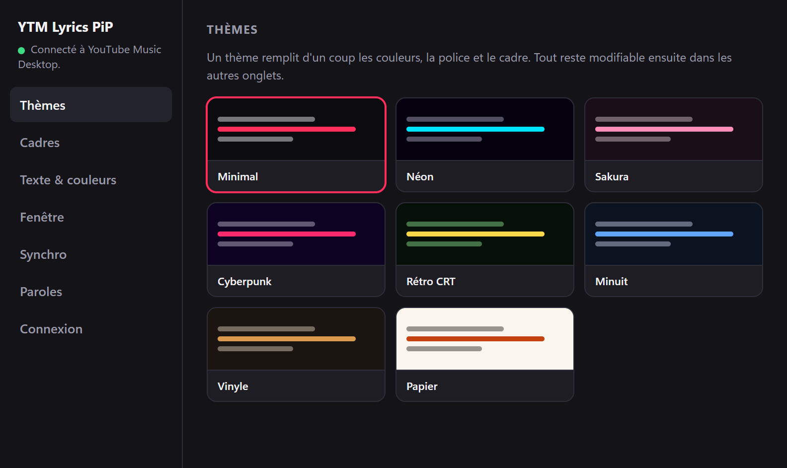
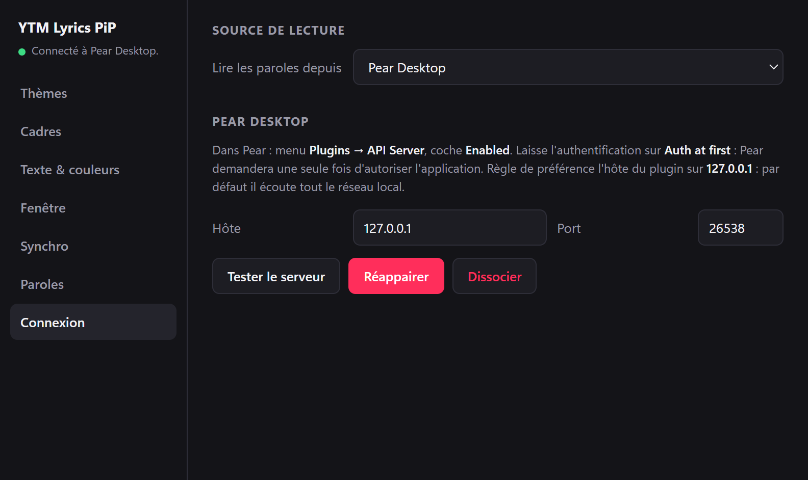

# YTM Lyrics PiP

**Les paroles du morceau en cours, synchronisées mot par mot, dans une petite fenêtre
toujours au premier plan.** Pour YouTube Music (via YouTube Music Desktop ou Pear
Desktop) et Spotify.

<p align="center">
  
</p>

- **Karaoké mot par mot** : chaque mot se remplit au rythme du chant, syllabe par
  syllabe quand la source le permet.
- **Fenêtre discrète** : sans cadre, au-dessus de tout, déplaçable et
  redimensionnable. Elle peut laisser passer les clics, et s'efface pendant les pauses.
- **Paroles trouvées automatiquement** sur [LRCLIB](https://lrclib.net) et NetEase,
  avec un filtre qui écarte les homonymes et les autres versions.
- **Synchro réglable d'un geste** : appuie sur `S` quand tu entends une ligne
  commencer, et l'app apprend ton décalage.
- **Huit thèmes et onze cadres**, tout reste personnalisable.
- **Commandes de lecture** depuis la fenêtre (⏮ ⏯ ⏭).

## Aperçu

<p align="center">
  
</p>

<table>
  <tr>
    <td width="50%"></td>
    <td width="50%"></td>
  </tr>
  <tr>
    <td align="center">Une ligne longue, remplie mot par mot</td>
    <td align="center">Syllabe par syllabe, quand la source est horodatée au mot</td>
  </tr>
</table>

<table>
  <tr>
    <td width="50%"></td>
    <td width="50%"></td>
  </tr>
  <tr>
    <td align="center">Réglages : thèmes</td>
    <td align="center">Réglages : connexion au lecteur</td>
  </tr>
</table>

> Les paroles des captures sont fictives, écrites pour l'aperçu.
> `npm run captures` les régénère à partir du vrai rendu de l'app.

## Lecteurs compatibles

| Lecteur | Connexion | Commandes de lecture |
| --- | --- | --- |
| [YouTube Music Desktop](https://github.com/ytmdesktop/ytmdesktop) v2+ | Companion Server intégré | Oui |
| [Pear Desktop](https://github.com/pear-devs/pear-desktop) (ex-« YouTube Music » de th-ch) | Plugin **API Server** | Oui |
| Spotify | API Web, compte Spotify | Compte Premium seulement |

Aucun de ces lecteurs n'accepte de plugin d'affichage : l'app est une application
compagnon qui se branche sur leur interface prévue pour les intégrations. Rien n'est
modifié dans le lecteur.

## Installation

L'app est développée et testée sous **Windows**.

**Depuis les sources** (Node.js 20+ et npm) :

```bash
npm install
npm start
```

**En exécutable** : `npm run dist` produit deux fichiers dans `release/` :

| Fichier | Usage |
| --- | --- |
| `YTM-Lyrics-PiP-<version>-Portable.exe` | Un seul exécutable, rien à installer : le plus simple à partager |
| `YTM-Lyrics-PiP-<version>-Setup.exe` | Installeur classique, avec choix du dossier et raccourci sur le bureau |

> **Les exécutables ne sont pas signés.** Au premier lancement, Windows SmartScreen
> affiche « Windows a protégé votre ordinateur » : *Informations complémentaires* →
> *Exécuter quand même*. Préviens les personnes à qui tu l'envoies.

Au premier lancement, la fenêtre de réglages s'ouvre sur l'onglet **Connexion**.

## Connecter son lecteur

Une seule fois par lecteur. Choisis-le dans **Réglages → Connexion → Lire les
paroles depuis**.

### YouTube Music Desktop

1. Dans YTMDesktop, **Settings → Integrations** :
   - active **Companion Server** ;
   - active **Enable companion authorization** juste avant d'appairer (YTMDesktop le
     désactive ensuite, c'est normal).
2. Dans l'app, clique **Appairer**.
3. Un code s'affiche des deux côtés : vérifie qu'ils correspondent, puis autorise
   dans YTMDesktop. Tu as 30 secondes.

### Pear Desktop

1. Dans Pear, menu **Plugins → API Server**, coche **Enabled**. Laisse
   l'authentification sur **Auth at first**. Règle de préférence l'hôte du plugin sur
   `127.0.0.1` : par défaut, il écoute tout le réseau local.
2. Dans l'app, choisis **Pear Desktop**, puis **Appairer** (port 26538 par défaut).
3. Pear ouvre une fenêtre pour autoriser le client `ytmlyricspip` : accepte.

### Spotify

Spotify n'expose rien en local : l'app passe par son API Web, qui demande une
application enregistrée. C'est gratuit et à faire une seule fois.

1. Sur le [tableau de bord développeur Spotify](https://developer.spotify.com/dashboard),
   **Create app**.
2. Dans **Redirect URIs**, ajoute exactement `http://127.0.0.1:8888/callback`.
3. Coche **Web API**, enregistre, copie le **Client ID** dans l'app, puis
   **Connecter Spotify**.

La connexion utilise OAuth PKCE : aucun secret dans l'exécutable. La synchro est un
peu moins fine qu'avec les deux autres lecteurs, car Spotify doit être interrogé
environ une fois par seconde, et la latence réseau s'ajoute.

Les jetons et réglages sont enregistrés dans `%APPDATA%/ytm-lyrics-pip/config.json`.

## Utilisation

| Action | Comment |
| --- | --- |
| Déplacer la fenêtre | Glisser n'importe où sur la carte |
| Redimensionner | Poignée en bas à droite (visible au survol) |
| Lecture / pause | `Espace`, ou les boutons au survol |
| **Caler les paroles** | `S` (ou le bouton `⏱`) au moment où une ligne commence |
| Ajuster finement | `[` et `]` (±100 ms) pour le morceau en cours |
| Remettre ce morceau à zéro | Clic sur la valeur de décalage affichée |
| Masquer | `Échap`, le bouton `✕`, ou clic sur l'icône de la zone de notification |
| Laisser passer les clics | Menu de l'icône → *Verrouiller* |
| Réglages | Menu de l'icône → *Réglages*, ou le bouton `⚙` |

### Si les paroles sont en avance ou en retard

Appuie sur **`S` au moment exact où tu entends une ligne commencer**. L'app calcule
le décalage, compense ton temps de réaction et le mémorise pour ce morceau. La
touche se change dans **Réglages → Synchro**.

Après trois calages, l'app en déduit le décalage propre à ta configuration (latence
audio, retard du lecteur) et l'applique d'office aux morceaux jamais calés.

Deux réglages coexistent :

- le **décalage par morceau** (`S`, `[` / `]`) corrige une version précise, par
  exemple un clip dont l'intro décale tout ;
- le **décalage global** (Réglages → Synchro) corrige ta configuration et
  s'applique partout.

Le pied de la fenêtre indique la source des paroles et leur précision :
**« horodaté au mot »** quand la source date chaque mot, **« mots estimés »** quand
l'app répartit elle-même la ligne entre les mots.

## Personnalisation

- **Thèmes** : Minimal, Néon, Sakura, Cyberpunk, Rétro CRT, Minuit, Vinyle, Papier.
  Un thème remplit couleurs, police et cadre d'un coup ; tout reste modifiable.
- **Cadres** : sept statiques et quatre animés (lueur pulsée, scanlines défilantes,
  pétales, balayage rotatif). L'interface indique le coût de chacun.
- **Texte et couleurs** : taille, police, graisse, alignement, couleurs, opacités,
  rayon des coins.
- **Fenêtre** : éléments affichés au survol, escamotage pendant les pauses et son délai.

Chaque changement s'applique immédiatement.

## Dépannage

**« Aucune parole trouvée ».** Le morceau n'existe synchronisé ni sur LRCLIB ni sur
NetEase, ou les résultats ont été écartés : autre artiste, ou durée trop différente.
Les absences sont réessayées après 24 h. *Vider le cache des paroles* (menu de
l'icône) force une nouvelle recherche immédiate.

**« autre version (+29 s) » dans le pied de la fenêtre.** Les paroles sont les
bonnes, mais leur horodatage vient d'une autre version (clip contre audio). Cale avec
`S`.

**Les paroles natives de YouTube Music n'apparaissent pas.** Ni YTMDesktop ni Pear
ne les exposent aux applications externes. Sans version synchronisée, l'app affiche
le texte brut, qui défile au rythme du morceau.

**Pear : « réappairer ».** Pear a perdu la configuration de son plugin, et l'ancien
jeton n'est plus valable : clique **Réappairer**. Pear n'a pas de menu pour révoquer
une application ; « Dissocier » efface seulement le jeton côté app.

**`npm start` échoue avec `Cannot read properties of undefined (reading 'getAppPath')`.**
La variable `ELECTRON_RUN_AS_NODE` est héritée (VS Code l'exporte). `npm start` passe
par `scripts/start.mjs`, qui la retire ; lancer `electron .` directement ne le fait pas.

## Développement

| Commande | Effet |
| --- | --- |
| `npm start` | Compile et lance l'application |
| `npm run build` | Compile TypeScript → `dist/` |
| `npm run watch` | Compilation en continu |
| `npm test` | Tous les tests : escamotage, apprentissage et calcul du calage, reprises, paroles (accès réseau), Pear, horloge |
| `npm run preview` | Capture le rendu de la PiP dans `preview/`, sans lecteur |
| `npm run preview:reglages` | Capture la fenêtre de réglages (`PREVIEW_PANEL=p-sync`…) |
| `npm run captures` | Régénère les captures du README dans `docs/captures/` |
| `npm run calibrer` | Mesure la cadence de chant sur des paroles LRCLIB |
| `npm run calibrer:mots` | Mesure l'estimation mot à mot contre le mot-à-mot réel de NetEase |
| `npm run icon` | Régénère `assets/icon.png` |
| `npm run dist` | Construit l'installeur et l'exécutable portable dans `release/` |

```
src/
  main/
    index.ts          Cycle de vie, zone de notification, IPC, orchestration
    config.ts         Configuration persistée, décalages par morceau
    calibration.ts    Apprentissage du décalage global à partir des calages
    autohide.ts       Escamotage pendant les pauses (machine à états)
    ytmd.ts           Client Companion Server (appairage, socket.io, commandes)
    players/
      types.ts        Interface commune des lecteurs
      ytmd-source.ts  YouTube Music Desktop
      pear.ts         Pear Desktop (API Server : REST + WebSocket)
      spotify.ts      Spotify (API Web, PKCE, sondage)
    lyrics/
      index.ts        Orchestration des sources, alignement, cache disque
      match.ts        Nettoyage des métadonnées, similarité, filtre d'acceptation
      lrc.ts          Parsers LRC, LRC enhanced et yrc
      words.ts        Horodatage au mot (timings de la source ou estimation)
      lrclib.ts       Source LRCLIB
      netease.ts      Source NetEase (appoint)
      http.ts         Requêtes JSON tolérantes
    windows/          Création des fenêtres PiP et réglages
  preload/            Ponts contextIsolation
  renderer/
    pip/              Fenêtre PiP (horloge locale, rendu synchronisé)
    setup/            Fenêtre de réglages
  shared/             Types et thèmes partagés
```

### Fonctionnement en détail

<details>
<summary><b>Horloge locale</b> : interpoler entre deux positions du lecteur</summary>

Les lecteurs ne rapportent la position qu'environ une fois par seconde, bien trop
grossièrement pour un remplissage mot par mot. Le renderer maintient donc une horloge
locale (ancre + `performance.now()`).

À chaque mise à jour, elle absorbe la moitié de l'écart **en changeant de vitesse**
(±20 % au plus) plutôt qu'en sautant : elle ne recule jamais, donc un mot à moitié
rempli ne se vide plus. Les écarts sous 30 ms sont ignorés (bruit de mesure). Elle se
recale d'un coup en cas de saut réel : seek, changement de morceau, pause, reprise,
dérive de plus de 1,2 s. `scripts/test-horloge.cjs` le vérifie sur le vrai renderer.

</details>

<details>
<summary><b>Remplissage mot par mot</b> : timings réels, ou estimés</summary>

Chaque mot est un `<span>` distinct qui porte sa propre progression. Un dégradé posé
sur la ligne entière serait calculé sur sa boîte : dès qu'une ligne passe à la ligne,
toutes les rangées se rempliraient en même temps.

**Timings réels.** Le LRC *enhanced* (`<mm:ss.xx>`) et le `yrc` de NetEase datent
chaque mot, voire chaque syllabe. Ils sont utilisés tels quels, fin de mot comprise,
en respectant l'espacement de la source : un segment `yrc` sans espace final est une
syllabe (« beau|ti|ful » reste un mot), et le japonais n'est pas éclaté en
caractères séparés par des espaces. Quand LRCLIB n'a que des lignes, NetEase est
aussi interrogé. Son `yrc` n'est retenu que si ses lignes tombent au même moment
(écart médian ≤ 0,6 s sur au moins 4 lignes communes) ; sinon, c'est une autre
version de l'enregistrement.

**Estimation.** Sinon, `src/main/lyrics/words.ts` répartit la ligne entre les mots
au prorata de leurs caractères, en comptant **double le dernier mot**, presque
toujours tenu. La répartition se fait sur une durée de chant de
`0,35 s + caractères / 7`, bornée par l'écart jusqu'à la ligne suivante. Les blocs
japonais ou chinois sont découpés par caractère.

Ces paramètres viennent de `npm run calibrer:mots`, qui compare l'estimation au
mot-à-mot réel de NetEase (20 morceaux, ~5 900 débuts de mots, surtout en anglais) :
erreur médiane **253 → 191 ms**, moyenne 431 → 340 ms, 43 % des mots à 150 ms près au
lieu de 35 %. Le gain tient en validation croisée (chaque moitié du corpus réglée sur
l'autre). Le français n'y figure pas : NetEase n'a presque pas de `yrc` français.

Les passages instrumentaux (lignes vides) affichent `♪ ♪ ♪`, qui s'étirent sur tout
l'écart : c'est ce qui montre que le morceau avance pendant le silence.

</details>

<details>
<summary><b>Recherche des paroles</b> : sources, filtre d'acceptation, clip contre audio</summary>

**[LRCLIB](https://lrclib.net)** d'abord : catalogue ouvert, sans clé d'API,
métadonnées propres. **[NetEase](https://music.163.com)** en appoint : bien meilleure
couverture en japonais, coréen et chinois, et souvent du `yrc` horodaté au mot. Son
API n'est pas officielle : elle peut changer ou être restreinte, et toute erreur s'y
solde par « pas de résultat », jamais par un échec de la recherche.

La recherche essaie plusieurs stratégies : correspondance exacte
artiste / titre / album / durée, puis titre nettoyé (`(Official Video)`,
`(Remastered 2011)`, chaînes `- Topic`…), puis recherche floue. Tous les résultats
passent par un **filtre d'acceptation** commun, qui exige une ressemblance suffisante
sur l'artiste *et* sur le titre. Sans lui, la recherche par titre seul ramène
volontiers l'homonyme d'un autre interprète : des paroles parfaitement
synchronisées, mais celles d'un autre morceau.

Le drapeau « instrumental » de LRCLIB est contributif et parfois faux : il n'est
retenu qu'après avoir consulté **toutes** les sources. Les lignes de crédits que
NetEase horodate en tête de fichier (`作曲 : …`, `Produced by : …`) sont écartées.

La tolérance sur la durée est **modulée**, car un même morceau ne dure pas pareil en
clip et en audio :

| Correspondance artiste + titre | Écart de durée toléré |
| --- | --- |
| Nette (≥ 0,85 sur les deux) | 45 s : c'est une autre *version* du bon morceau |
| Approximative | 10 s : le doute porte sur l'identité du morceau |

Au-delà de 12 s d'écart, le pied de la fenêtre l'indique (`autre version (+29 s)`).
C'est aussi pourquoi le décalage va jusqu'à ±30 s.

</details>

<details>
<summary><b>Reprises</b> : chercher les paroles de l'original</summary>

Quand le titre annonce une reprise (`(Cover)`, `[Acoustic Cover]`, `- Piano Cover`,
`| Cover by X`, `Reprise…`) et que la recherche normale n'a rien donné, une seconde
passe cherche les paroles de **l'original**.

Elle n'intervient jamais en premier : ignorer l'interprète est précisément ce qui
ramène les paroles d'un autre morceau. En compensation, l'exigence sur le titre passe
de 0,5 à **0,8** de similarité, et la détection réclame un contexte (parenthèses,
séparateur, ou « by ») : « Cover Me In Sunshine » ou « Cover Girl » ne déclenchent
rien. Quand le titre nomme l'original (`Adele - Someone Like You (Cover)`), l'artiste
sert à départager les candidats, jamais à en écarter.

Les timings de l'original sont **étirés linéairement** sur la durée de la reprise
(`timings ×0.78` dans le pied de la fenêtre). La référence est le maximum entre la
durée du catalogue, souvent fausse, et le dernier horodatage du fichier, plus 5 s
d'outro. Hors d'un rapport de tempo de ×0,6 à ×1,6, rien n'est étiré et le libellé
invite à caler à la main.

</details>

<details>
<summary><b>Calage et apprentissage</b> : pourquoi la médiane, et pourquoi pas le son</summary>

« Caler ici » vise la ligne dont l'horodatage est le plus proche de la position
affichée : l'erreur à corriger est par construction plus petite que l'écart entre
deux lignes. Le temps de réaction (150 ms) est compensé. `scripts/test-calage.cjs`
éprouve le calcul sur le vrai renderer, **sens compris** : une erreur de signe
aggraverait l'écart sans que rien ne le signale.

Chaque calage est une mesure. À partir du **3ᵉ**, la **médiane** des 20 dernières
devient le décalage global, bornée à ±3 s. Médiane plutôt que moyenne, pour qu'une
frappe ratée ne déplace pas l'estimation. Promouvoir la médiane ne change rien aux
morceaux déjà calés : leurs décalages propres sont rebasés de l'écart exact.
`scripts/test-calibration.cjs` vérifie cette invariance.

Aligner les paroles sur le son du système est possible (`setDisplayMediaRequestHandler`
avec `audio: 'loopback'`), mais le loopback capte **tout** le son de la machine. Une
notification ou une vidéo dans un autre onglet fausserait l'alignement sans
prévenir : une correction silencieusement fausse est pire qu'un calage manuel
prévisible.

</details>

<details>
<summary><b>Économie de ressources</b></summary>

La boucle de rendu n'écrit, à chaque frame, que la progression d'un seul mot. Cadres,
dégradés et halos sont peints une fois. S'y ajoutent :

- l'**escamotage pendant les pauses** (activé par défaut) : une fenêtre masquée ne
  rend plus rien du tout. Il est piloté par le processus principal, car Chromium bride
  les minuteries d'un renderer masqué. Sa machine à états distingue « masquée par
  l'app » de « masquée par l'utilisateur » (`scripts/test-autohide.cjs`) ;
- en pause, l'horloge est figée et la boucle rend la main immédiatement ;
- une fenêtre masquée annule la boucle, relancée à la réapparition ;
- la progression est arrondie au dixième de pour-cent, pour ne pas réécrire un style
  identique.

Les cadres animés n'animent que `opacity` et `transform`, sauf le balayage rotatif,
cadencé à 8 repeints par seconde (`steps(40)`). Les animations s'arrêtent quand la
fenêtre est masquée, et sont coupées si le système demande des animations réduites.

</details>

<details>
<summary><b>Cache des paroles</b></summary>

Les résultats sont mis en cache dans `%APPDATA%/ytm-lyrics-pip/lyrics-cache/`, avec
la version de la logique de recherche qui les a produits. Quand cette logique change,
les entrées périmées sont supprimées et les paroles retéléchargées. Les absences sont
réessayées après 24 h ; au-delà de 1200 fichiers ou 24 Mo, les plus anciennes entrées
sautent. L'horodatage au mot est calculé à l'envoi et non stocké : une meilleure
estimation profite aussi aux paroles déjà en cache.

</details>

## Licence

MIT
